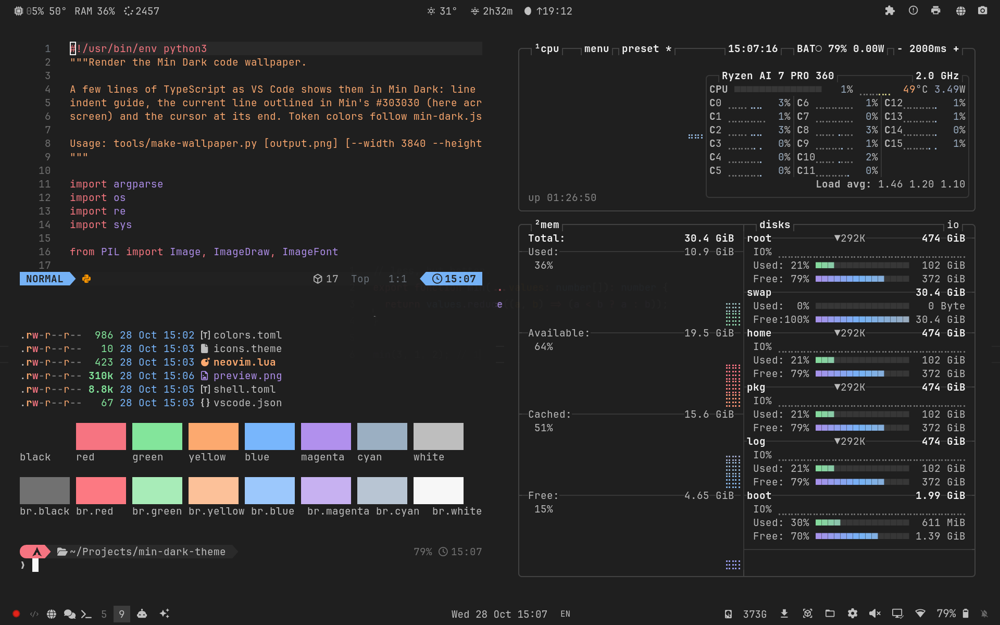

# Min Dark — an Omarchy theme

[Min Dark](https://github.com/miguelsolorio/min-theme), Miguel Solorio's minimal
VS Code theme, for the whole Omarchy desktop: gray chrome, gray text, and color
only where code needs it.



## Install

```bash
omarchy theme install https://github.com/JarnKet/omarchy-min-dark-theme
```

### VS Code and Neovim

Omarchy colors VS Code and Neovim from `colors.toml` for any theme. For the
original Min Dark in the editors:

- **VS Code:** install `miguelsolorio.min-theme` and pick *Min Dark*.
- **Neovim:** the theme's `neovim.lua` loads
  [min-theme.nvim](https://github.com/datsfilipe/min-theme.nvim).

Omarchy won't let a theme installed from a git repo install a VS Code extension
or run Lua, so `vscode.json` and `neovim.lua` only take effect from a linked
checkout (see Developing). Then switching to the theme sets both editors to
Min Dark by itself.

## Palette

| Role               | Hex       | From Min Dark                  |
|--------------------|-----------|--------------------------------|
| background         | `#1F1F1F` | editor background              |
| dark background    | `#1A1A1A` | side bar, status bar, tabs     |
| lighter background | `#2A2A2A` | inputs, indent guides          |
| selection          | `#383838` | badges, active indent guide    |
| foreground         | `#C1C1C1` | badge text                     |
| muted              | `#727272` | line numbers                   |
| accent, border     | `#C1C1C1` | white-gray, as Min's UI        |
| red                | `#F97583` | keywords                       |
| magenta            | `#B392F0` | functions, types               |
| blue               | `#79B8FF` | constants                      |
| cyan               | `#9DB1C5` | strings                        |
| yellow             | `#FFAB70` | quoted strings, tags           |
| orange             | `#FF9800` | parameters                     |
| green              | `#85E89D` | GitHub Dark (Min has no green) |

The text and every terminal color but the two blacks pass WCAG 4.5:1 on the
background (bright black, Min's line-number gray, is 3.4:1). The bright
variants are lighter steps of the same colors.

## Files

- `colors.toml`: the palette. Omarchy generates terminals, Hyprland borders,
  Chromium, Claude Code, gum, Helix, etc. from it.
- `shell.toml`: bar, popups, menus and notifications on Min's `#1A1A1A`
  chrome with its `#444444` focus border, so only the active window border is
  light.
- `btop.theme`: gray boxes; only the graphs carry color.
- `vscode.json`, `neovim.lua`: the original Min Dark in the editors (see above).
- `icons.theme`: `Yaru-gray`.
- `backgrounds/1-min-code.png`: a few lines of TypeScript as VS Code shows them
  in Min Dark, rendered by `tools/make-wallpaper.py` from `colors.toml`.
- `preview.png`: the theme switcher thumbnail, from `tools/make-preview.sh`
  (takes over an empty workspace for about 10 seconds).
  `tools/palette.sh` prints the terminal palette.

## Developing

Link a checkout instead of installing, so edits apply on the next
`omarchy theme set min-dark`:

```bash
ln -s ~/Projects/min-dark-theme ~/.config/omarchy/themes/min-dark
```

## How this was made

The idea and the choices are mine: a Min Dark desktop, a white-gray accent
instead of a color, and a code wallpaper. The files were written by Claude
(Anthropic's AI) in Claude Code from what I asked for. I tried the theme on my
own machine and take responsibility for what's here.

## Credits

The colors are [Min Theme](https://github.com/miguelsolorio/min-theme)'s, by
Miguel Solorio (MIT). The Neovim colorscheme is
[min-theme.nvim](https://github.com/datsfilipe/min-theme.nvim) by datsfilipe
(MIT). Not affiliated with either.

## License

MIT; see [LICENSE](LICENSE).
